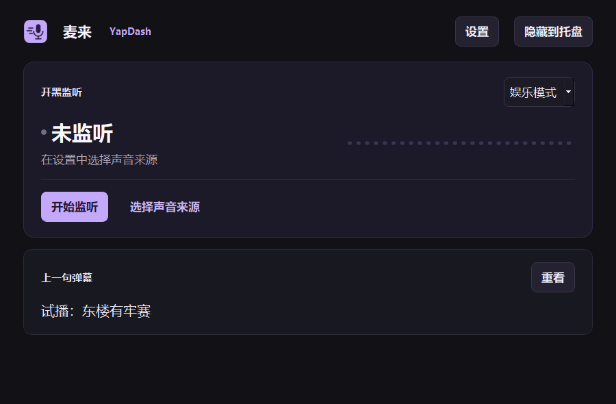

# 麦来 · YapDash

Windows 开黑语音弹幕。它监听你选中的应用，在本机转写队友语音。命中关键词时，屏幕上显示识别到的整句话。比如词库有「牢赛」，队友说「东楼有牢赛」，弹幕就显示「东楼有牢赛」。



## 功能

- 按 Windows 进程采集 KOOK、Oopz 等应用的播放声音，使用 SenseVoice 在本地转写中英文语音。
- 默认使用纯净模式，以普通弹幕显示完整原句。娱乐模式支持漫画字、贴纸、方向路牌和单挑大字。
- 新词库预装 300 多条《三角洲行动》关键词，含地图、报点、干员、物资、枪械及常用简称。支持编辑、TXT 导入导出、左右报点和短时间防刷屏。
- 游戏术语支持同音和近音匹配，弹幕会用词库写法显示整句。可在「关键词 → 匹配与弹幕设置」逐词调整读音匹配。
- 「调试模式」在窗口右侧显示原始转写、纠正结果和关键词命中状态，可以开启默认麦克风自行测试。
- 可以选开整句原声回放。语音和昵称校准图像在本机处理，回放只在内存中短暂缓冲。
- 朋友可用建议链接提交词条与特效改动，由词库主人审核。限时共编需要手动授权，到期失效。

## 从源码启动

需要支持应用回环采集的 Windows（建议 Windows 11）和 Python 3.9–3.12。在项目目录打开 PowerShell，运行：

```powershell
powershell.exe -NoProfile -ExecutionPolicy Bypass -File ".\安装依赖和模型.ps1"
.\.venv\Scripts\pythonw.exe .\launch.pyw
```

安装脚本会创建项目内的虚拟环境，安装推理依赖。Windows 压缩包附带 SenseVoice 和 Silero VAD，安装时会复用包内模型。从源码安装时，脚本会补齐缺失模型。语音转写在本地运行。

如需编译双击启动的 Windows EXE，可用系统自带的 .NET Framework C# 编译器：

```powershell
& "$env:WINDIR\Microsoft.NET\Framework64\v4.0.30319\csc.exe" /nologo /target:winexe /optimize+ /codepage:65001 /reference:System.Windows.Forms.dll /win32icon:app.ico /out:麦来.exe launcher.cs
```

## 第一次使用

1. 打开 KOOK 或 Oopz，进入语音房。
2. 在「设置 → 音频与诊断」选择对应应用，再回首页点击「开始监听」。
3. 打开「设置 → 词包与试用」试播「东楼有牢赛」，或在「设置 → 关键词」配置自己的词条。
4. 如需分享，到「设置 → 共享」生成建议链接。异地访问可选 [Cloudflare Quick Tunnel](https://developers.cloudflare.com/tunnel/get-started/quick-tunnels/) 或自己的 HTTPS 反向代理。使用 Quick Tunnel 时，把官方 Windows 版 `cloudflared.exe` 放在项目旁或加入 PATH。

常用快捷键为 `Ctrl+Shift+F9` 重看上一句、`Ctrl+Shift+F10` 关闭整蛊并清屏，以及 `Ctrl+Shift+F8` 在娱乐模式试播「区」。游戏叠加可先用无边框窗口模式测试。

进一步的配置和限制见[使用说明](使用说明.md)。麦来是独立桌面工具，与 KOOK、Oopz 或《三角洲行动》没有官方关联。
