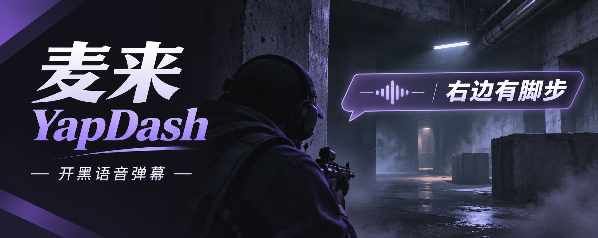

# 麦来 · YapDash



枪声盖住了队友报点？麦来把 KOOK 或 Oopz 里的关键语音变成游戏画面上的整句弹幕。错过了还可以按 `Ctrl+Shift+F9` 重看上一句。

## 下载麦来

- **Windows 安装版** · 下载后双击安装，可创建桌面快捷方式，也可从 Windows 设置卸载。安装程序暂未签名。[下载安装程序](https://github.com/JasonZhangOR/YapDash/releases/download/v1.0.0/YapDash-Setup.exe)
- **Windows 免安装版** · 完整解压后双击 `麦来.exe`。[下载免安装 ZIP](https://github.com/JasonZhangOR/YapDash/releases/download/v1.0.0/YapDash-Portable.zip)
- **源码版** · 适合想查看代码或自行构建的用户。解压后按下方「从源码启动」操作。[下载源码 ZIP](https://github.com/JasonZhangOR/YapDash/archive/refs/tags/v1.0.0.zip)

安装版和免安装版均面向 64 位 Windows 11，内含运行环境和语音模型。

| 你在玩 | 麦来可以抓什么 |
| --- | --- |
| 三角洲行动 | 「东楼有牢赛」「有人堵桥」 |
| CS2 | 「香蕉道有两个」「下默认包」 |
| 瓦洛兰特 | 「爆能器掉在中路」「已经拆了一半」 |
| 明日方舟 · 卫戍协议 | 「先锁店，下回合三连」「这波帮我联防」 |

在首页选「监听词库」就能切换。三角洲行动、CS2 和瓦洛兰特也支持按游戏进程自动切换。你可以加自己的报点和队内黑话。语音转写在 Windows 本机完成。

日常开黑用默认的**纯净模式**，只看整句弹幕。想玩点花样，切到**娱乐模式**，给朋友的口头禅配上漫画字和贴纸，还有更多隐藏内容。

[查看长版产品海报 · 把开黑聊天变成弹幕](product-poster-voice-chat.png)


## 功能

- 按 Windows 进程采集 KOOK、Oopz 等应用的播放声音，使用 SenseVoice 在本地转写中英文语音。
- 默认使用纯净模式，以普通弹幕显示完整原句。娱乐模式支持漫画字、贴纸、方向路牌和单挑大字。
- 新词库预装《三角洲行动》。在「设置 → 词包与试用」还可添加 CS2、瓦洛兰特（无畏契约）、明日方舟通用和卫戍协议。卫戍协议可单独添加，含盟约、干员晋升、商店和联防报点。支持编辑、TXT 导入导出、左右报点和短时间防刷屏。
- 游戏术语支持同音和近音匹配，弹幕会用词库写法显示整句。可在「关键词 → 匹配与弹幕设置」逐词调整读音匹配。
- 「调试模式」在窗口右侧显示原始转写、纠正结果和关键词命中状态，可以开启默认麦克风自行测试。
- 可以选开整句原声回放。语音和昵称校准图像在本机处理，回放只在内存中短暂缓冲。
- 朋友可用建议链接提交词条与特效改动，由词库主人审核。限时共编需要手动授权，到期失效。

## Windows 安装

双击 `YapDash-Setup.exe`，选择是否创建桌面快捷方式，点「安装」。安装包已经包含运行环境和语音模型，安装后可从开始菜单打开麦来。需要卸载时，在 Windows「已安装的应用」里找到「麦来 · YapDash」。词库和设置会保留。

## 从源码启动

需要支持应用回环采集的 Windows（建议 Windows 11）和 Python 3.9–3.12。在项目目录打开 PowerShell，运行：

```powershell
powershell.exe -NoProfile -ExecutionPolicy Bypass -File ".\安装依赖和模型.ps1"
.\.venv\Scripts\pythonw.exe .\launch.pyw
```

安装脚本会创建项目内的虚拟环境，安装推理依赖。Windows 压缩包附带 SenseVoice 和 Silero VAD，安装时会复用包内模型。从源码安装时，脚本会补齐缺失模型。语音转写在本地运行。

如需编译双击启动的 Windows EXE，可用系统自带的 .NET Framework C# 编译器：

```powershell
& "$env:WINDIR\Microsoft.NET\Framework64\v4.0.30319\csc.exe" /nologo /target:winexe /optimize+ /codepage:65001 /reference:System.Windows.Forms.dll /win32icon:app.ico /out:麦来.exe launcher.cs
```

## 第一次使用

1. 打开 KOOK 或 Oopz，进入语音房。
2. 在「设置 → 音频与诊断」选择对应应用，再回首页点击「开始监听」。
3. 在首页的「监听词库」选游戏，或选择「自动识别游戏」。想先看效果，可打开「设置 → 词包与试用」试播整句。
4. 如需分享，到「设置 → 共享」生成建议链接。异地访问可选 [Cloudflare Quick Tunnel](https://developers.cloudflare.com/tunnel/get-started/quick-tunnels/) 或自己的 HTTPS 反向代理。使用 Quick Tunnel 时，把官方 Windows 版 `cloudflared.exe` 放在项目旁或加入 PATH。

常用快捷键为 `Ctrl+Shift+F9` 重看上一句、`Ctrl+Shift+F10` 关闭整蛊并清屏，以及 `Ctrl+Shift+F8` 在娱乐模式试播「区」。游戏叠加可先用无边框窗口模式测试。

进一步的配置和限制见[使用说明](使用说明.md)。麦来是独立桌面工具，与 KOOK、Oopz 或《三角洲行动》没有官方关联。
